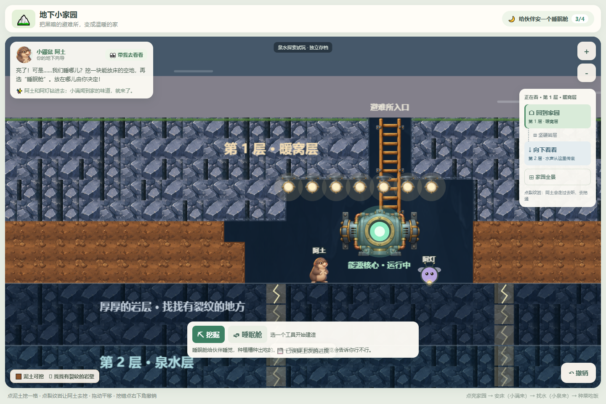

# 阿土视觉升级 v1 验收

日期：2026-10-18。范围：只升级阿土形象；没有新增玩法或依赖。

## 结果

- `npm test -- --reporter=dot`：19个文件、196项测试全部通过；新增3项渲染回归检查，补充既有睡眠检查。
- `npm run build`：TypeScript类型检查与Vite生产构建通过，无构建警告。
- 生产预览的独立Chromium上下文：1440×960和900×620画面；正常加载时未捕获页面运行错误、控制台警告。
- 实际鼠标点击裂纹岩：新造型阿土挥镐后只挖开一块，下一块保留；点撤销恢复岩石，并核对IndexedDB落盘结果。
- 主动阻断全部新角色PNG：游戏继续初始化，画布退回程序造型，头像显示“阿土”。此故障场景允许资源错误和备用造型警告，没有未处理的页面运行异常。
- 睡眠、灯亮前后、窄屏、头像统一已逐图检查。睡眠使用同一闭眼图的头部区域，避免整身缩小时脸部太小。

浏览器测试使用当前`serialize`/`deserialize`校验通过的初始、点亮、有床、已升级铁镐四份测试档；通过独立浏览器上下文在本地5191来源写入。没有访问、迁移或覆盖用户浏览器中的进度。它不是从零完整游玩的验证；入床路径、取消演出、阿灯出现等由既有自动化测试覆盖。本轮没有实体触摸设备或儿童试玩。

## 实景截图

| 文件 | 内容 |
| --- | --- |
| [01-dark-home.png](01-dark-home.png) | 黑暗中仍能认出阿土，头像与场景统一，阿灯仍躲在角落 |
| [02-lit-home.png](02-lit-home.png) | 点亮后的阿土与场景材质、尺寸对照 |
| [03-sleeping.png](03-sleeping.png) | 闭眼头部与被子；小满仍在大厅等床 |
| [04-pickaxe.png](04-pickaxe.png) | 探索阿土与小铁镐；原床位不再出现另一只阿土 |
| [05-undone.png](05-undone.png) | 撤销恢复岩块 |
| [06-narrow.png](06-narrow.png) | 900×620视口 |
| [07-missing-art-fallback.png](07-missing-art-fallback.png) | 阻断新角色图片后的备用造型 |

## 变更文件

- `src/render/moleVisual.ts`：独立角色素材加载与视觉模块，统一朝向、呼吸、眨眼、睡眠和受光；失败时返回备用路径。
- `src/render/PixiRenderer.ts`：接入新造型、单独受光、保留原落点和入床缩放；探索时隐藏大厅分身。
- `src/render/explorationScene.ts`：复用同一个阿土，保留原移动、落镐和取消时序；小铁镐跟随朝向。
- `src/App.vue`：同源角色头像及图片失败回退。
- `src/assets/art/characters/`：两张409×512透明角色图、一张160×160头像和`ATU_V1.md`（来源、规格、完整提示词）。
- `tests/terrain-renderer.test.ts`：脚底位置、夜间分层、世界数据不变、统一形象、分身隐藏/取消恢复、素材失败与睡眠回归。
- `docs/CHARACTERS.md`、根`README.md`、本目录：实施范围、验收与截图。

## 未完成项与边界

- 阿灯、小满、小泉本轮未升级图片，当前与阿土的美术精度仍有差异。
- 当前为静态素材加程序动画，没有逐帧迈腿、挖土爪子或攀爬肢体动画；缩到全景时脸部细节不作为辨识依据。
- 睡眠舱仍为原程序示意造型。
- 核心玩法、世界数据、存档格式和键名未改；用户工作区原有的`docs/ART_PLAN.md`和`png素材/`未改动。

完整生成提示词与裁切规格见 [ATU_V1.md](../../../src/assets/art/characters/ATU_V1.md)。使用内置image_gen生成，没有使用CLI或另行配置API密钥。
