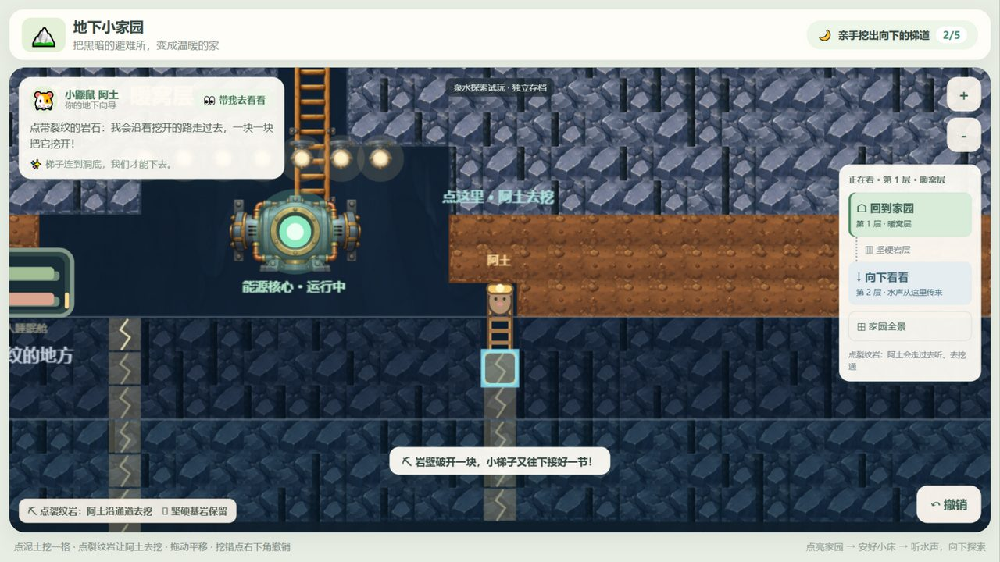
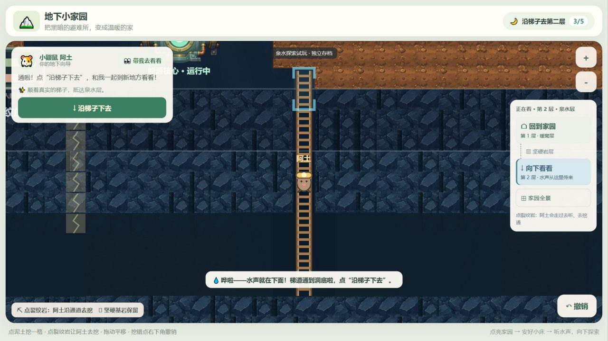

# 施工委托式探索验收

日期：2026-10-17。基线：`b1fb502`；分支：`codex/first-spring-breakthrough`。本轮为操作定位收口，只提交 Git，不发布。

## 执行结果

- `npm test -- --reporter=dot`：15 个测试文件，**136 项全部通过**（较上一轮新增 4 项：施工目标解析、自动路线、半挖梯道存档、点空地不移动）。
- `npm run build`：vue-tsc 类型检查、Vite 生产构建通过，无构建警告。
- 真实浏览器（内置浏览器，127.0.0.1:5175 开发服务器）从"已点亮家园 + 小床入住"的档完整走了一遍新流程：点裂纹 → 阿土走到梯口听水声 → 换小铁镐 → 逐段委托破岩（每段落镐后梯子接长、目标环下移）→ 挖通时水声与水汽反馈 → 沿梯子下去 → 点泥土开路 → 点泉水让阿土走到水边 → 5/5。中途刷新两次，进度与半挖梯道均从存档完整恢复。
- 页面运行期间未捕获到任何 `error` / `unhandledrejection`，没有出现初始化失败提示；壁灯、撤销等既有功能保持可用。

## 试玩路线（复现）

1. `npm run dev -- --host 127.0.0.1 --port 5175`，打开 http://127.0.0.1:5175/（新来源即新档）。
2. 走完原主线：挖能源石 → 收集 → 修核心 → 自选位置建睡眠舱并入住。
3. 挖通裂纹上方的泥土（普通泥土仍是点一下就挖，不需要先移动阿土），点带裂纹的岩石：阿土会从大厅沿地面走到裂纹上方，到位后才播滴水提示（1/5）。
4. 点"换上小铁镐"，再点裂纹岩：阿土沿梯道走到该段上方挥镐，落镐时岩块破开、木梯接长；目标环自动移到下一段。点已经挖开的空洞格同样会继续挖下一段。
5. 最后一段破开时：水声、洞口凉风水汽、洞底光环，洞口透出一线微光（"梯道通到洞底啦"）。
6. 点"沿梯子下去"，抵达后才开放第二层；点泥土一路挖到泉水；看到"天然泉水 · 点一下，阿土去看看"后点泉水，阿土自己走到水边完成 5/5。
7. 试试点已经挖空的空地：阿土不再四处走动，只提示这里已挖空；点"安一盏小壁灯"仍可自由选址。

## 实景截图

均来自真实运行画布（内置浏览器截屏）。

| 文件 | 验证点 |
| --- | --- |
| 01-crack-cue-after-listen.jpg | 听水声后阿土站在梯口、裂纹出现"换上小铁镐，点裂纹挖下去"阶段提示（1/5） |
| 02-first-break-target-ring.jpg | 第一次委托破岩：阿土下到梯段里挥镐，岩块破开、梯子接长，下一段套上目标环 |
| 03-pickaxe-swing-closeup.jpg | 挥镐动作放大：落镐前小铁镐举在身前（0.42s 抬镐 → 落镐回调） |
| 04-empty-cell-tap-continues.jpg | 点已经挖开的空洞格：自动继续挖下一段（阿土逐段下移） |
| 05-breakthrough-fog-peek.jpg | 挖通瞬间：水声/水汽/洞底光环，洞口透出一线微光与"沿梯子下去"引导 |
| 06-arrived-water-layer.jpg | 沿梯子抵达泉水层：迷雾揭开，图例与楼层提示改为"点泥土或泉水就行" |
| 07-spring-revealed.jpg | 地面挖到泉水：泉水露面并提示"点一下，阿土去看看" |
| 08-spring-found-5of5.jpg | 点泉水后阿土走到水边，5/5 与发现庆祝 |
| 09-wall-lamp-no-errors.jpg | 壁灯自由选址仍可用；同一时刻控制台无错误 |

## 浏览器验证的说明与限制

- 画布上的挖掘/委托全部是**真实指针点击**（先移动再按下抬起，逐格确认存档瓦片变化）。
- 界面按钮（睡眠舱 / 确认建造 / 换上小铁镐 / 沿梯子下去 / 安一盏小壁灯）在本轮的内置浏览器面板里，真实点击会被画布吞掉（面板的 DOM 输入通道未把点击派发给覆盖层，画布自己收得到）。这些按钮改用页面内的真实 `click()` 事件触发，事件确实进入了 Vue 处理器（同一次会话中用"放大"按钮验证过：zoom 由 1.3652 变为 1.4852）。这是**验证环境的输入通道限制**，不是应用问题；按钮逻辑本身没有改动。
- 面板在后台时动画会被节流（画面帧率下降），个别委托走路会停在半途并保持"阿土正在沿通道赶过去"的锁定提示；刷新后从存档恢复即可继续，未产生错误状态。这一点也顺带验证了"半挖梯道 + 阿土站在梯段里"的新存档校验：刷新两次都能读回（2/5、3/5 进度与梯道形状一致）。
- 没有实体平板触控、也没有儿童参与本轮测试。

## 变更文件

- 规则/存档：`src/core/exploration.ts`、`missions.ts`、`persistence.ts`。
- 装配：`src/app/session.ts`（删除自由移动，新增委托分流与破岩编排）。
- 画面：`src/render/explorationScene.ts`、`PixiRenderer.ts`。
- 界面：`src/App.vue`（图例、底栏、楼层提示）。
- 测试：`tests/exploration.test.ts`、`tests/session-exploration.test.ts`。
- 文档：`docs/BUILDER_ORDERS_SCOPE.md`、本目录、`README.md`。

## 本轮边界与待试玩项

- 只改操作定位：地下分层、梯子自动接长、任务链、存档版本、美术素材、依赖清单均未改动；没有新增角色控制、居民 AI、资源或新玩法。
- 仍只有一条梯道可用；两条裂纹的"先探索哪条"规则不变，另一条只给提示。
- 待用户试玩判断：委托一次约 1 秒的演出节奏是否合适；"点裂纹岩，阿土自己来挖"是否一眼能懂；挥镐动作与裂纹脉冲的清晰度；突破时的水声/水汽是否足够惊喜。
