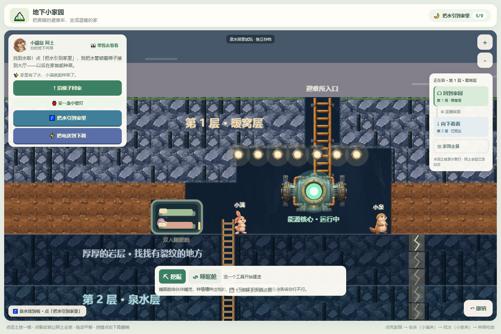

# 阿灯、小满、小泉视觉升级 v1

日期：2026-10-18。接续阿土视觉升级，范围仅为三位伙伴的美术与渲染表现。

## 已完成

- 三位各有一对同姿态的透明PNG（睁眼/闭眼），沿用阿土的绘本配色和柔和体积感。
- 阿灯：触角、浅色翅膀与有机尾灯；闲时漂浮、尾光轻微脉动；原躲藏、修好核心后飞回大厅、名字出现的时序保留。
- 小满：一立一垂长耳朵、两颗门牙；移动时轻跳；建好第一间床后出现。
- 小泉：奶油色脸、三根胡须与粗尾巴；移动时轻摇；找到泉水后出现。
- 呼吸、短暂眨眼、左右朝向、闭眼睡眠和被子由代码表现。睡眠只采样头部，按物种抬高脸部，眼睛不会被被子盖住。
- 每位独立回退；其中一位PNG失败不会拖累其他伙伴，也不会阻止游戏初始化。

## 验证

- `npm test -- --reporter=dot`：19个测试文件、199项全部通过；新增3项回归，并补充原有阿灯出场检查。
- `npm run build`：TypeScript检查及Vite生产构建通过，无构建警告。
- 新素材均有实际alpha通道；每位的两帧共用裁切框、对齐后等比缩至512px高。
- 独立Chromium上下文访问生产预览，确认6张新PNG全部加载；正常场景没有页面运行异常或控制台警告。见 [浏览器记录](browser-report.json)。
- 实际指针点击能源核心，检查阿灯躲藏、点亮飞出、恢复名字；检查有床、小满到来、找到泉水后小泉到来、两间床的闭眼睡眠、刷新恢复与900×620视口。
- 主动阻断小满图片：画布继续启动，小满使用原程序造型；阿土、阿灯、小泉仍为图片。该故障场景会有预期资源错误/回退警告，没有未处理的页面异常。

浏览器验证使用当前`serialize`/`deserialize`校验通过的测试档，经真实挖掘/建造规则准备，写入独立浏览器上下文。没有读写用户浏览器的进度，也没有执行从零开始的完整通关。入床路径、出场条件、原移动/挖掘/撤销行为由现有自动化测试回归覆盖；没有实体触摸设备或儿童试玩。

## 实景

| 文件 | 内容 |
| --- | --- |
| [01-hidden-adeng.png](01-hidden-adeng.png) | 核心未修好时，阿灯缩在角落，尾灯可见 |
| [02-adeng-reveal.png](02-adeng-reveal.png) | 点击修复核心后的阿灯与点亮反馈 |
| [03-adeng-settled.png](03-adeng-settled.png) | 原自动拉远结束，阿灯名字可见 |
| [04-xiaoman-arrived.png](04-xiaoman-arrived.png) | 第一间床后小满出现，阿土与阿灯休息 |
| [05-xiaoman-xiaoquan.png](05-xiaoman-xiaoquan.png) | 找到泉水后，小满与小泉在大厅等待床位 |
| [06-resting.png](06-resting.png) | 两间床，兔耳、闭眼脸部和尾灯可辨；阿土已去探索 |
| [07-narrow.png](07-narrow.png) | 900×620的现有界面布局 |
| [08-xiaoman-fallback.png](08-xiaoman-fallback.png) | 小满图片被阻断，其余角色保持新造型 |

## 变更文件

- `src/render/companionVisual.ts`：三位角色的素材加载、头部采样、动作、尾光与独立回退；提供轻量画面接口。
- `src/render/PixiRenderer.ts`：在原伙伴生命周期中接入三位造型，复用原路径、出场、床位、名字和点亮演出。
- `src/assets/art/characters/`：新增`adeng`、`xiaoman`、`xiaoquan`各两张PNG及`COMPANIONS_V1.md`。
- `tests/terrain-renderer.test.ts`：轮廓尺寸、落点、动画不改世界、单角色回退、四位闭眼入床及阿灯尾光回归。
- `README.md`、`docs/CHARACTERS.md`、本目录：当前状态、素材规格、截图和验证记录。

## 当前边界

- 仍为静态图片加程序动画，没有独立翅膀拍动、耳朵摆动或完整肢体帧动画。
- 睡眠舱继续使用原程序示意造型。
- 900×620中，原有建造面板会遮住部分角色脚部，楼层导航也会压缩右侧空间。本轮保留该界面布局，后续可单独做小屏操作区调整。
- 核心规则、出场条件、地图、输入、存档格式与依赖没有改动；未加入居民AI。

素材使用内置image_gen生成，六个文件的规格、裁切框与最终提示词见 [COMPANIONS_V1.md](../../../src/assets/art/characters/COMPANIONS_V1.md)。
