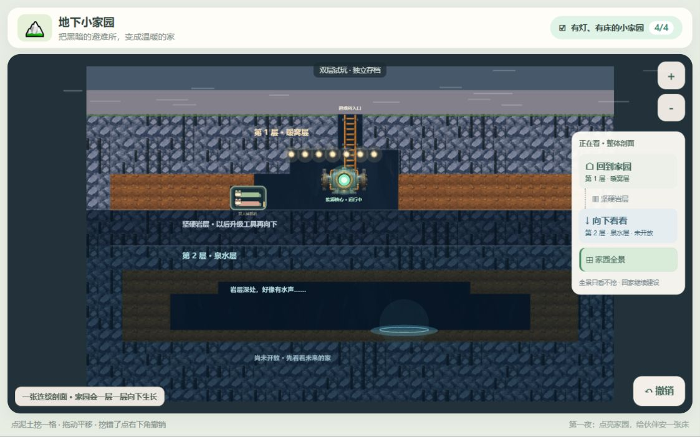

# 双层住宅尺度原型 · 待用户验收

日期：2026-10-17。分支：`codex/two-layer-depth`。独立工作树：`C:/Users/ZhuanZ/.codex/worktrees/two-layer-depth/Underground-Home`。

## 最终变化

一层按照房间高度定义：住宅两翼净高3格，睡眠舱2格，共用y12的硬岩地板，空间向左右延展；核心大厅保持5格高度以容纳现有设施。整图44×28，三格厚硬岩隔开第二层低矮天然泉水洞。第二层只提供期待，不能挖掘或建造。保留现有Vue3/PixiJS架构、手绘PNG、四步任务、建舱确认/取消、撤销、点灯和入住演出。

镜头提供回家、向下看看、整体剖面三个目标；拖动时楼层提示随视口中心变化。全景禁止挖掘，回家恢复操作缩放。核心只点亮第一层，深层保持冷色与黑暗。

## 启动与试玩

已启动的本地入口：

- `http://127.0.0.1:5185/`：生产构建预览，保留全新0/4进度，供从头试玩。
- `http://127.0.0.1:5184/`：开发版，已有本次浏览器验收的点灯与建舱进度。

重启命令（在此工作树执行）：

```powershell
npm run dev -- --host 127.0.0.1 --port 5184 --strictPort
# 或在构建后预览生产版：
npm run build
npm run preview -- --host 127.0.0.1 --port 5185 --strictPort
```

建议试玩顺序：

1. 点“家园全景”，先判断能否清楚读出两层，以及每层是否像一层可住的房间；全景点击土块应只出现说明。
2. “回到家园”，点击左侧泛蓝光土格找到能源石，再点击收集、点击核心点灯。
3. 在暖窝层左右任选位置挖空间。最容易复现的左侧舱位：挖开x12–14、y10–11共6格，选择睡眠舱并点击(13,11)，预览后确认。右侧同层也可自由选址。
4. 观察伙伴沿大厅共同地面入舱，入住后任务显示4/4。点撤销应移除舱并返回3/4；重建后刷新应恢复舱与睡眠。
5. 点“向下看看”，观察镜头向下经过岩层，第二层保持昏暗；点击深层土块会提示未开放。一键回家继续建设。
6. 在泥土上拖动只平移；点击只挖一格，撤销可恢复普通土块。岩石地板和层间盖层不可挖。

两种端口是不同浏览器来源，进度各自独立。原型默认仅访问 `underground-home-depth-prototype-v2` 数据库，v4格式，绝不打开正式版 `underground-home` 数据库。没有正式旧档导入或重置流程；读失败时保留失败数据，禁止覆盖，本次只临时试玩。

## 真实验证结果

- 修改前基线：12个测试文件、104项通过。
- 最终 `npm test`：13个测试文件、115项全部通过。新增/调整覆盖住宅净高与连续地板、厚岩隔层、第二层挖建锁定、扩建单格撤销、落地入舱路径、镜头全景边界、分层暗度、原型数据库隔离、事务中止、旧尺寸存档不被修改、能源石不可隔土收集。
- 最终 `npm run build`：`vue-tsc --noEmit`和Vite生产构建通过。
- `git diff --check`：通过。
- 实际IAB浏览器已从0/4完成找石、收集、点灯、自由建舱、入住；检查普通挖掘撤销、拖动不误挖、建舱撤销到3/4及重建、刷新恢复4/4、向下镜头、返回家园、全景禁止挖掘、第二层锁定反馈。
- 生产预览另行打开并确认正常渲染，未替用户推进新档。最终开发版与生产版浏览器日志未见warn/error。
- 横屏视口请求1280×800、平板1024×768均检查；浏览器缩放后CSS视口约1123×702和898×674。另检查窄屏CSS视口342×740无页面横向溢出；这不代表已完成手机触控验收。临时视口覆盖已还原。
- 源项目仍在 `feat/m1-pod-placement`，原有未提交的`.gitignore`、评审、美术计划和素材文件保持原样。

## 截图（实际游戏，无合成）



| 文件 | 场景 |
| --- | --- |
| [01-initial.jpg](01-initial.jpg) | 第一层初始状态 |
| [02-single-dig.jpg](02-single-dig.jpg) | 单击只挖一格 |
| [03-pod-preview.jpg](03-pod-preview.jpg) | 同层地面上的建造预览 |
| [04-inhabited-home.jpg](04-inhabited-home.jpg) | 入住后，舱与大厅共享地板 |
| [05-overall-section.jpg](05-overall-section.jpg) | 点灯建舱后的整体剖面 |
| [06-water-preview.jpg](06-water-preview.jpg) | 未开放的低矮泉水洞预览 |
| [07-reloaded-home.jpg](07-reloaded-home.jpg) | 刷新恢复点灯与睡眠舱 |
| [08-tablet-home.jpg](08-tablet-home.jpg) | 平板横屏家园 |
| [09-production-initial.jpg](09-production-initial.jpg) | 生产构建的新试玩档 |

## 变更文件

- `src/core/world.ts`：双层蓝图、分带元数据、住宅净高与地板、泉水和建造引导坐标。
- `src/core/dig.ts`、`build.ts`：深层锁定；原挖掘、承托与通路规则保留。
- `src/core/interact.ts`：防止从落地入口空格提前收走未发现能源石。
- `src/core/persistence.ts`：v4、独立数据库默认值、等待事务完成与中止反馈。
- `src/render/strataScene.ts`：既有PNG冷色调、地层标记；`PixiRenderer.ts`：分层暗度、泉水预览、楼层镜头、收小伙伴待机弹跳。
- `src/render/camera.ts`：全景适配与当前楼层计算。
- `src/app/session.ts`、`src/App.vue`：导航、全景防误挖、同格悬停去重、失败存档防覆盖、关闭页面保存、楼层提示及窄屏控件排布。
- `tests/depth.test.ts`及原有world/build/dig/interact/friend-routes/terrain-renderer测试：按新蓝图保留并扩展有效行为断言。
- `README.md`、`docs/DEPTH_PROTOTYPE_SCOPE.md`、本验收记录与截图；评审文档从源项目原样复制进工作树供交接。

## 未完成与下一步边界

等待用户判断层高、上下层关系、层内自由建设感。尚未做真实儿童试玩或目标平板实机帧率测量。伙伴、睡眠舱和泉水仍沿用示意造型；无水声音效。第一间舱的规则仍支持在实心土台上放置，因此不是严格自动吸附地板的建筑编辑器；常用地面布局已无需爬墙。

第二层解锁、工具升级、竖向交通、跨层居民行为、层灯、泉水生产和温室全部留待后续。当前没有可穿过厚岩的交通，伙伴不会前往第二层；未来开放时必须配套可见交通。正式旧档迁移须在蓝图验收后另行设计。撤销只限本次会话，刷新不会恢复撤销栈。

独立分支可整体弃用或回退，不影响源项目与正式存档。本阶段不合并到原开发分支。
