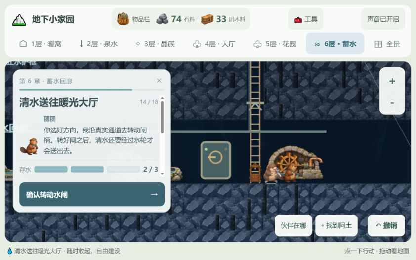
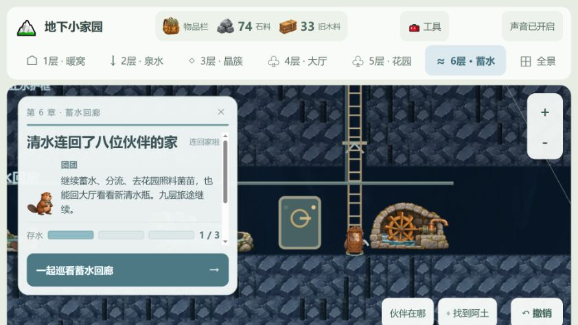

# 第六章 · 蓄水回廊验收

2026-10-25。本轮只实施第六层与河狸团团，第九层继续为终章。规则与交互完整范围见 [LAYER6_SCOPE.md](../../LAYER6_SCOPE.md)。

## 真实结果

| 检查 | 最终结果 |
| --- | --- |
| 全量 Vitest（单 worker） | **51 个文件、590 项通过，0 失败**，比第五层增加 33 项 |
| `npm run build` | **通过**：TypeScript／Vue 检查、Vite 生产构建 |
| `git diff --check` | **通过**；既有 LF／CRLF 转换提示 |
| 四张 ImageGen 透明 PNG | RGBA，alpha 0—255，已查看原图；合计 9.24 MB |
| 浏览器实际操作 | 蓄水 0→3，选择／确认花园水路，提水 3→2，确认大厅水路，提水 2→1，再巡游；确认章末完成状态 |
| 短屏／窄屏 | 修正主要操作裁切；398×756 独立 iframe 视口文档宽与滚动宽均为 398，主按钮在视口内 |

记录：[verification-summary.json](verification-summary.json)、[test-results.json](test-results.json)、[browser-audit.json](browser-audit.json)。本轮没有新增依赖、发布或部署。

并行执行全量测试和构建时曾出现系统内存提交失败，开发服务器连接也受影响；切换为单 worker 全量测试、随后独立构建后均成功。没有把失败那次计为通过。最终主 JS 820.94 kB、gzip 273.95 kB，保留超过 500 kB 的体积提示。

## 行为覆盖

- 两种梯口 x16／x27，检查→护框→逐段凿岩→实际到场；未加固仅阻止新施工，前五层不受破坏。
- 阿岩落手只凿一格，取消保留断点，重复结束和旧回调不能补挖；停帧／超时解锁。
- 滤水口、池、闸、轮自由选址，测试完全不同的顺序和布局；净空、梯口、重叠、材料和真实通路校验。
- 团团相遇后独立加入与出场说明，稳定身份和床位优先位 7；旧七位顺序不变，原六人宴仍固定六位。
- 管渠只沿已挖通的连续洞壁连接；伙伴真实走完整段再结算。
- 三格可见存水，满后停止；选择方向不改变水路，确认后团团到场落手才转闸；每次提水只扣一格。
- 花园两次清水照料真实生效，保留原有水光条件；撤销照料返还额度，已使用清水不可撤回。大厅实际收到水才出现瓶子和纪念。
- 三人巡游等阿土、团团、小泉到场才完成，分别记录三个站位；旧床可复用，缺床不能跳过。
- 六站电梯按真实当前楼层发车；未延长不能提前进入新站，旧五站保留。
- 真实 App 状态测试覆盖入口、相遇、选址、转闸确认、工作、庆典、全景、旧设施和对话交接；最多一个主要面板和主按钮。
- Pixi 对象测试覆盖角色前后层级、池内水位层级、团团独立造型与移动、小屏定位、流动反馈生命周期。
- 七类本地合成音效服从总静音和后台停止；没有外部音频请求。
- v20 新档与真实 v19 44×64 旧档迁移；v16—v18 旧档回归。中间施工、水位、水路、照料额度、角色站位可恢复，伪造加固、管渠、水量和加入条件拒绝。
- 物品栏记录两件可选发现并可定位，计数上限不会生成无法加载的存档。

## 实景修正与截图

本轮恢复了内置浏览器连接，实际打开项目专用内存存档。实景发现并修正：水位被石池图片遮住、短屏主按钮被裁切、水面矩形与池口透视不协调、水轮转动标记轴心偏高。当前主要动作固定在滚动说明之外；相遇和庆典留在当前面板，中央成就卡不同时出现。

浏览器尺寸覆盖请求未实际改变窗口，桌面检查使用当前约 842px 宽的真实窗口；手机布局使用 `reservoir-device.html` 中 **398×756 的真实 iframe 视口**，通过实际画面与 DOM 尺寸检查，无横向溢出。没有把这一检查称为实体手机触控测试。

分水闸确认时，当前水路仍为花园，下一选择是大厅，水位为 2／3；按钮确认后才施工。

第六章完成态的隔离存档复检：

## 待做与边界

- 实体平板／手机的点挖与拖图手感，实际音量和长时间试听，首次加载与低性能设备帧率仍待测试。
- 插画总量较大，首次加载与显存占用仍有优化空间；此次不更换全部旧素材或重做加载架构。
- 团团使用静态原画加程序移动、转闸和睡眠裁切，没有额外多帧眨眼／睡眠图集。水轮为静态插画加旋转轴标记和水珠，未制作逐帧轮体动画，不模拟流体物理。
- 第七至九层未实施；不新增战斗、洪水惩罚、后端或离线消耗。

## 隔离复现

运行 `npm run dev -- --host 127.0.0.1 --port 5174`：

- `/tests/manual/reservoir.html`：花园章末完成，尚未检查新岩缝。
- `?phase=entered`：已进入第六层，准备挖通左侧去见团团。
- `?phase=working`：四件水工设施与管渠已接好，可验证蓄水和分流。
- `?phase=completed`：已完成，可验证重复供水、巡游、六站电梯和旧层回馈。
- `/tests/manual/reservoir-device.html`：398×756 窄屏完成态，只用于布局验收。

全部使用内存存档，不读取／覆盖玩家 IndexedDB，不进入正式构建入口。

## 主要文件

| 职责 | 变更 |
| --- | --- |
| 规则、拓扑与存档 | `src/core/reservoir.ts`、`reservoirTopology.ts`、`world.ts`、`persistence.ts`、`history.ts` |
| 行动与界面 | `src/app/reservoirChapter.ts`、`session.ts`、`saveSummary.ts`、`src/components/ReservoirPanel.vue`、`src/App.vue` |
| 伙伴、床位、通行 | `src/core/partners.ts`、`partnerWork.ts`、`partnerInteractions.ts`、`atu.ts`、`exploration.ts`、`dig.ts`、`build.ts` |
| 清水回馈与导航 | `src/core/garden.ts`、`bag.ts`、`src/app/hallChapter.ts`、`gardenChapter.ts`、`itemArt.ts`、旧三层面板与 `DepthNavigation.vue`、`InventoryDialog.vue` |
| 画面与声音 | `src/render/reservoirScene.ts`、`reservoirSound.ts`、`PixiRenderer.ts`、`companionVisual.ts`、`partnerMotion.ts`、四张 reservoir PNG |
| 测试与设计 | 新规则／会话／fixture／手动页，扩展 attention、audio、renderer、session、deep 与旧档测试；`docs/LAYER6_SCOPE.md`、总体基线、README |
