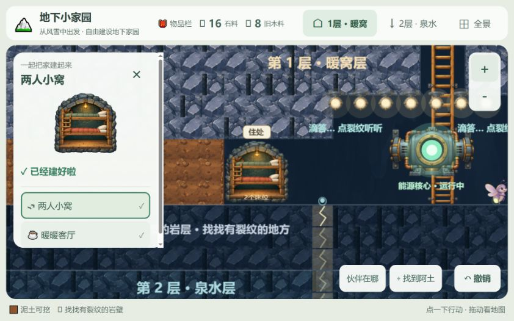

# 两人小窝美术验收

2026-10-20。范围为小窝美术样板，素材与完整最终提示词见[美术记录](../../NEST_ART_V1.md)。

## 已完成

两张内置image_gen生成的透明PNG分别表现石拱/木梁/后墙/暖灯与双层木床。素材保存在`src/assets/art/rooms/`，由`src/render/nestArt.ts`统一加载。`RoomScene`与`sleepPods`分层绘制，`SiteTools.vue`复用素材组合卡片；`PixiRenderer`接入资源与小灯呼吸。床头按入口镜像，地形、占地、通行、材料及存档规则均不修改。

同时收起已建房间的选址色块、“就在这里”提示和卡片重复状态句，避免遮挡材质。旧尺寸不符合3×3单元的房间保留原外框；床铺使用新图。客厅、菜园继续使用现有造型。

## 验证

- `npm test`：32个测试文件，352项全部通过，包含床位朝向、角色路径、房间表现不改世界、存档与建设回归。渲染测试新增素材加载mock，使用真实Pixi精灵与纹理对象。
- `npm run build`：Vue/TypeScript类型检查与生产构建通过。仍有现有主包超过500kB的提示。
- 浏览器实际继续旧存档，库存16石料/8旧木料、原建造成果正常恢复；查看小窝时地图与卡片使用相同美术。
- 检查横屏和窄侧栏：小窝预览完整、不再只显示上半截；面板内容可滚动。放大地图后石拱与床铺仍正确贴在房间内，已建房间没有覆盖绿色选址块。
- 本轮未清空或重新开始存档；未在浏览器新建第二间小窝或重走整条剧情。

## 变更文件与后续

新增`src/assets/art/rooms/nest-shell-v1.png`、`nest-bunks-v1.png`、`src/render/nestArt.ts`、`docs/NEST_ART_V1.md`与本记录；修改`src/render/sleepPods.ts`、`roomScene.ts`、`PixiRenderer.ts`、`src/components/SiteTools.vue`、`tests/terrain-renderer.test.ts`与`CHANGELOG.md`。

待后续：客厅/菜园精细素材、真实儿童观感试玩，以及当前约4.7MB原始PNG的运行时压缩版本。本次保留完整alpha与生成原图，没有改变存档版本。
