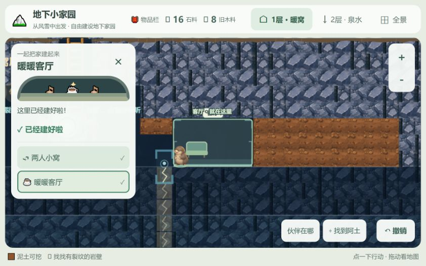

# 预设洞室与材料验收

日期：2026-10-20；本地开发页`http://127.0.0.1:5173/`。范围见[决策](../../PRESET_BUILDING_SCOPE.md)。

## 自动验证

- `npm test`：32个文件、352项测试全部通过。
- `npm run build`：Vue/TypeScript类型检查和Vite生产构建通过；仍有主包超过500kB的体积提示，不影响本次构建。
- 本次新增与更新的核心/会话用例验证：真实逐格挖掘、自动建床、连接走道、岩层保护、第二层用途二选一、自由区域未被清空、缺水/缺料/旧设施阻挡、取消过期回调、施工期间普通点击不打断内部队列、费用与退款、掉落与撤销、v12迁移、v13校验，以及旧蓝图继续施工。

## 浏览器实测

使用已有本地存档继续，未清空或重新开始。检查了窄侧栏和横屏布局，建造面板在短视口可滚动，主动作保持可见。

1. 挖出能源石后，库存为5石料、3旧木料；修好核心，出现“去修小窝”和建设工具。
2. 打开两人小窝，只显示用途、费用、开工和其他洞室，不要求确定尺寸或位置。点开工后阿土真实施工，完成床位与房间；库存最终7石料、4旧木料（新增挖掘掉落并扣3+2）。
3. 开发页重载后继续游戏，床位、房间、任务进度及7/4库存恢复。
4. 修建暖暖客厅，库存变16/8。点撤销后变20/10，客厅设施移除，空间保留；再次开工立即复用已挖空间，库存恢复16/8，未重复掉落。
5. 最终保留已建小窝和客厅，方便继续试玩。截图为实际页面，见下图。

## 验证边界

第二层两种用途、接水前阻止建菜园、取消施工和旧档蓝图通过自动回归验证；本轮没有在浏览器重走整条第二层剧情。尚未组织7岁儿童现场试玩，易用性仍需真实观察。旧房间、场景和素材沿用现有版本，没有增加第三层或制作配方树。

## 本轮主要变更文件

规则：`src/core/sites.ts`、`materials.ts`、`dig.ts`、`history.ts`、`world.ts`、`persistence.ts`；施工：`src/app/siteEditor.ts`、`atuOrders.ts`、`session.ts`；界面与渲染：`src/App.vue`、`src/components/SiteTools.vue`、`src/render/roomScene.ts`、`lootFeedback.ts`、`PixiRenderer.ts`；引导：`src/core/missions.ts`、`partnerInteractions.ts`；回归：`tests/sites.test.ts`、`session-exploration.test.ts`、`room-construction.test.ts`。README、更新记录和设计基线同步指向新决策。
