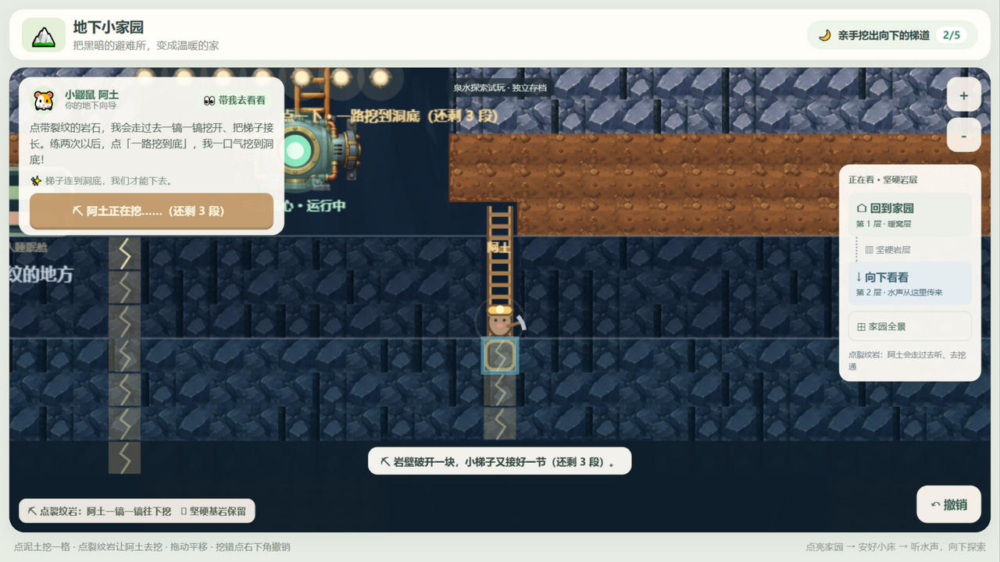
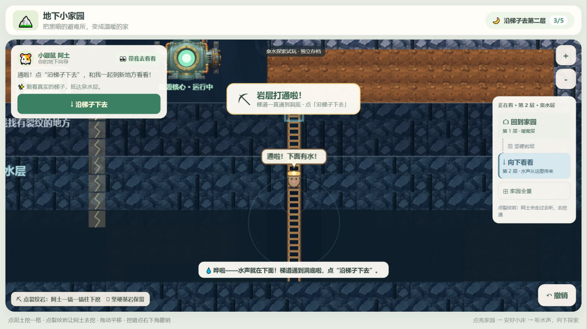
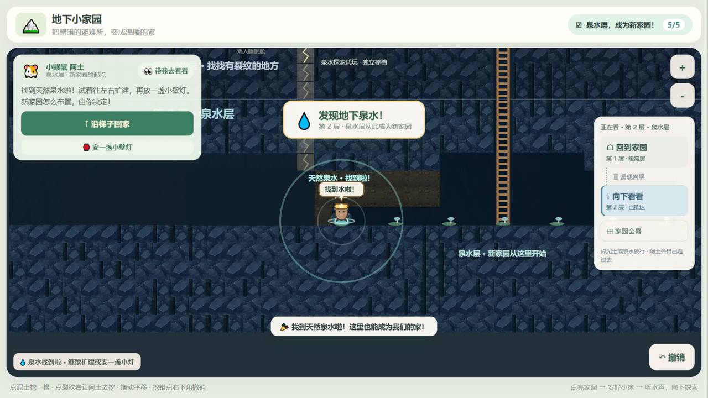

# 第二层体验优化验收

日期：2026-10-17。基线：`670592d`；分支：`codex/first-spring-breakthrough`。本轮只提交 Git，不发布、不合并。

## 执行结果

- `npm test`：15 个测试文件，**145 项全部通过**（较上一轮新增 5 项：剩余段数与解锁时机、半挖梯道往返一致、一次点击连挖到底、切后台安全取消+回来接续、画面冻住时看门狗解锁、慢但在动不打断、渲染层取消不改世界）。
- `npm run build`：vue-tsc 类型检查、Vite 生产构建通过，无构建警告。
- 真实浏览器（内置浏览器，127.0.0.1:5188 开发服务器）走完整个新增流程：两段手动委托 → 一键连挖到底（阿土逐段走位挥镐、梯子逐段接长、剩余段数实时更新）→ 打通岩层里程碑 → 沿梯子抵达第二层里程碑 → 开路到泉水 → 发现泉水里程碑（5/5）。中途刷新多次，半挖梯道与第二层进度都从 v5 存档完整恢复。
- 页面运行期间未捕获到 `error` / `unhandledrejection`，没有初始化失败提示；自由挖掘、撤销、建造、楼层导航均照常可用（本轮回归验证了单击挖土、向上拓宽、坚硬岩石拒绝、撤销恢复原材质）。

## 试玩路线（复现）

1. `npm run dev -- --host 127.0.0.1 --port 5188`，打开 http://127.0.0.1:5188/（新来源即新档）。
2. 走完原主线到"安好睡眠舱 + 入住"，挖通裂纹上方的泥土，点裂纹听水声，换小铁镐。
3. 点裂纹岩：阿土沿梯道走到该段上方挥镐，落镐时岩块破开、木梯接长，洞口短语与提示里带「还剩 N 段」。
4. 再点一次挖第二段；从第三段开始，小鼹鼠面板出现 **「⛏ 一路挖到底（还剩 N 段）」**，点它（或继续点裂纹岩）就会一口气挖到洞底，每一段仍然是真实走位 + 挥镐 + 梯子接长。
5. 最后一段破开：水声、沿梯道冒出的凉风水汽、洞底光环、镜头拉出整条梯子、阿土喊「通啦！下面有水！」，弹出里程碑卡片「⛏ 岩层打通啦！」。
6. 点"沿梯子下去"：抵达后弹「第 2 层 · 泉水层」卡片，迷雾揭开，冷色洞壁、苔藓、小蘑菇露出，阿土喊"到啦！水就在那边。"
7. 点泥土一路挖到泉水边（仍是单格单击，不需要先移动阿土），点泉水：阿土走到水边，水花 + 光环 + 上行四音 + 里程碑卡片「发现地下泉水！」，进度到 5/5，之后水面一直有波光。
8. 试试点"向上拓宽"（先挖地面格，再挖它上面一格）、点坚硬岩石（拒绝提示不变）、点右下角撤销（恢复成泥土）。

## 实景截图

均来自真实运行画布（内置浏览器截屏），画布上的操作全部是真实指针点击。

| 文件 | 验证点 |
| --- | --- |
| 01-ready-to-dig.png | 就绪状态：阿土站在梯口，第一段裂纹套着目标环，短语提示「点这里 · 阿土去挖」 |
| 02-first-order-swing.png | 第一次手动委托：落镐后岩块破开、木梯接长一段，提示带「还剩 5 段」 |
| 03-chain-button-appears.png | 第二段挖完：面板出现「⛏ 一路挖到底（还剩 4 段）」，洞口短语同步变成「点一下 · 一路挖到洞底」 |
| 04-chain-in-progress.png | 连续施工中：阿土在梯道里挥镐，梯子继续接长，按钮显示「阿土正在挖……（还剩 3 段）」，每条落地提示带剩余段数 |
| 05-breakthrough-milestone.png | 打通瞬间：里程碑卡片「⛏ 岩层打通啦！」，阿土气泡「通啦！下面有水！」，水汽沿梯道冒出，洞底大光环，整条梯子可见 |
| 06-layer-arrival.png | 首次抵达第二层：卡片「🪜 抵达第 2 层 · 泉水层」，迷雾揭开，苔藓与蘑菇露出，阿土气泡「到啦！水就在那边。」 |
| 07-spring-found.png | 发现泉水：卡片「💧 发现地下泉水！」，三层水花 + 光环 + 波光常亮，进度 5/5 |
| 08-reloaded-mid-game.png | 刷新后：v5 存档恢复（梯道完整、进度 3/5、「💾 已恢复上次的进度」） |
| 09-narrow-screen-arrival.png | 900×520 窄屏：里程碑卡片与楼层信息仍可读 |

## 中断与恢复的验证记录

| 场景 | 操作 | 结果 |
| --- | --- | --- |
| 画面被冻住（宿主窗口不在前台，实测约 0 帧/秒） | 点泉水后不做任何操作 | 约 3 秒后提示「⏸ 阿土停下来了，再点一次就好。」，世界不变（泉水未发现、阿土仍在原位），按钮从"正在走"恢复可点；再点一次正常完成。**上一轮这种情形会一直卡在"阿土正在沿通道赶过去"，只能刷新页面** |
| 慢但在动 | 每 700ms 一帧推进 | 看门狗不打断，演出照常走完（单测覆盖） |
| 切后台（`visibilitychange: hidden`） | 走路途中切走 | 立即取消这次委托、输入解锁、世界保持原样，并立刻落盘一份一致存档；回到前台补一句提示（单测覆盖会话处理；浏览器里的隐藏态无法用手工事件伪造，见下） |
| 刷新 | 半挖梯道 / 抵达第二层 / 5/5 各刷新若干次 | 全部从 v5 存档完整恢复，无多余字段、无版本变化 |
| 窗口失焦 | 施工途中失焦 | 只复位指针手势，不打断施工（单测覆盖） |

## 浏览器验证的说明与限制

- 画布上的挖掘与委托全部是**真实指针点击**（移动 → 按下 → 抬起），每一步都用 IndexedDB 里的 v5 存档核对瓦片与探索字段。
- 界面按钮（一路挖到底 / 沿梯子下去 / 撤销）改用页面内真实 `click()` 事件触发：内置浏览器面板的 DOM 输入通道不会把点击派发给覆盖层，画布自己收得到。这是**验证环境的输入通道限制**，不是应用问题。
- 本轮所处的宿主窗口不在前台，页面的 `requestAnimationFrame` 几乎不出帧（实测 0～1.2 帧/秒，正常前台浏览器是 60）。这恰好把"动画被冻住"这条路径实测出来了：看门狗 3 秒收尾、世界不变、操作解锁。需要连续演出的截图（04/05/06/07）是在把面板重新切到前台、帧恢复之后拍的。
- `document.visibilityState` 在 `HTMLDocument.prototype` 上是**不可配置**的访问器，无法用手工事件伪造隐藏态，所以"切后台"这一条只在会话单测里覆盖（同一个 `abortOrder()` 路径已被"画面冻住"的实机场景验证）。
- 没有实体平板触控，也没有儿童参与本轮测试。

## 变更文件

- 规则：`src/core/exploration.ts`（梯段进度与连续施工可用性）、`src/core/missions.ts`（文案）。
- 会话：`src/app/session.ts`（委托生命周期与看门狗、连续施工、里程碑、回到前台补写存档）。
- 输入：`src/input/pointerControls.ts`（`reset()` 与 `lostpointercapture`）。
- 画面：`src/render/explorationScene.ts`（取消演出、阿土反应、剩余段数、泉水波光）、`src/render/PixiRenderer.ts`（取消接口、帧计数、破岩/发现泉水演出、平滑跟随）、`src/render/waterSound.ts`（三处轻量提示音）。
- 界面：`src/App.vue`（连续施工按钮、里程碑卡片、文案）。
- 测试：`tests/exploration.test.ts`、`tests/session-exploration.test.ts`、`tests/terrain-renderer.test.ts`。
- 文档：`docs/SPRING_UX_SCOPE.md`、本目录、`README.md`。

## 本轮边界与已知问题

- 只做体验优化：地下分层与蓝图、梯子规则、任务链、存档版本与存储键、美术素材、依赖清单都没改；没有水塔、温室、资源系统或新关卡。
- **已知（轻微，非阻塞）**：视口宽度小于约 1024px 时，居中的里程碑卡片会与左上角小鼹鼠面板有少量重叠（卡片在上层、文字完整可读，3 秒后自动收起）。900×520 的实测截图见 09。
- **已知（环境相关）**：如果整台设备的渲染帧被冻住（页面在后台、窗口被系统遮挡），连续演出只能播一小段就会被看门狗收尾。这是有意设计——宁可"再点一次"，也不让孩子对着一个卡住不动的阿土和锁死的按钮。正常前台浏览器不会触发。
- 仍只有一条梯道可用；另一条裂纹只给"以后再探索"的提示。
- 待用户试玩判断：一键连挖到底的节奏（4 段约 4～5 秒）、里程碑卡片的大小与停留时长（3 秒）、突破时的新音效音量是否合适。
