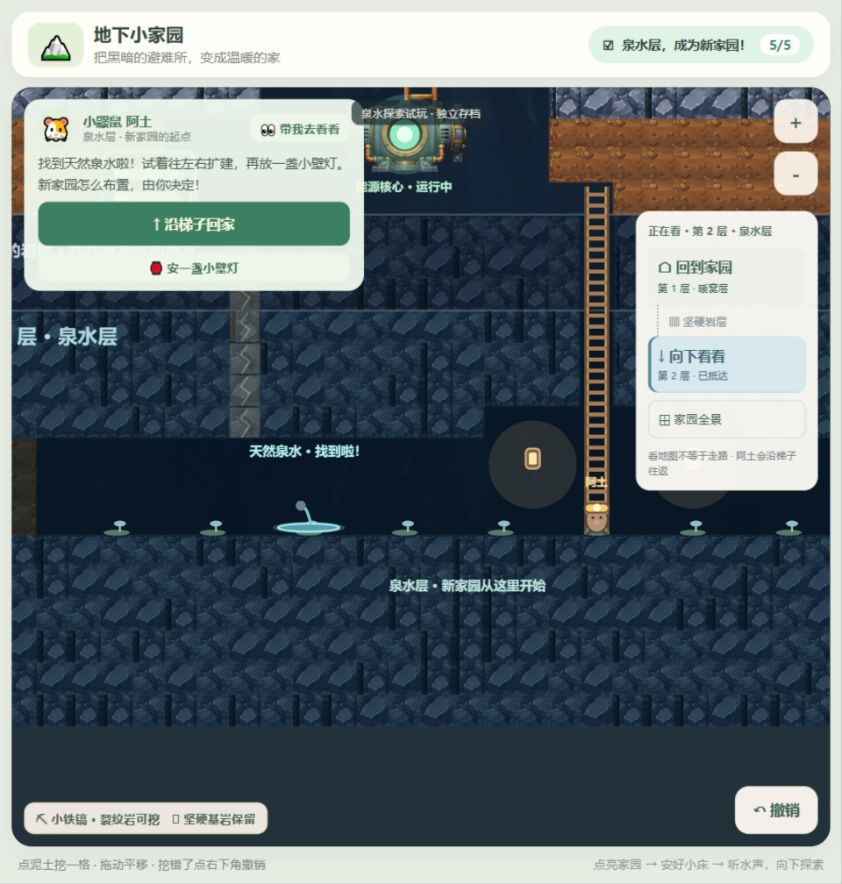
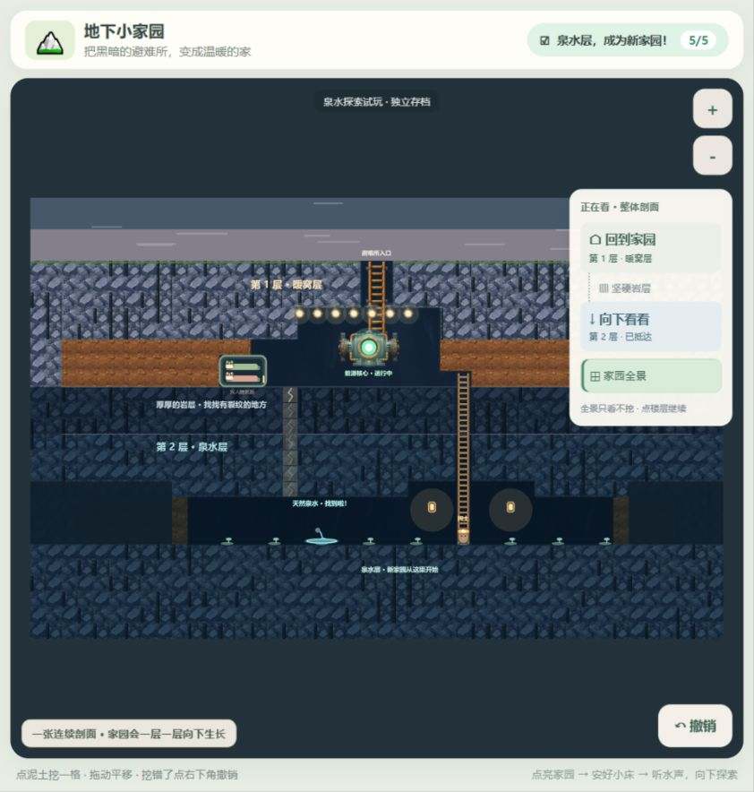

# 首次突破岩层与泉水探索验收

日期：2026-10-17。基线：v0.1.0；分支：`codex/first-spring-breakthrough`。此次只提交 Git，不发布。

## 执行结果

- `npm test -- --reporter=dot`：15 个测试文件，**132 项全部通过**。
- `npm run build`：vue-tsc 类型检查、Vite 生产构建通过，770 个模块，无构建警告。
- 内置浏览器真实点击从新档走完点灯、左翼自由建舱、入住、裂纹检查、升级、逐格挖通、下梯、挖土找泉水和到访庆祝。
- 换用 `vite preview` 的生产构建，在同一 127.0.0.1:5174 来源刷新恢复泉水、壁灯、地形、首层舱和阿土位置；实际往返上下层。
- 已操作检查弱岩撤销、壁灯自由多点布置与撤销、拖动土壁平移。拖动后撤销提示没有新增可撤销操作，未产生挖掘。
- 生产构建浏览器控制台检查：无 error / warn。
- 测试了正常侧栏与窄屏底部楼层导航；窄屏实际 DOM 视口为 421×592，行动按钮可见，楼层切换可用。没有实体平板触控或儿童参与本轮测试。

规则与会话测试特别覆盖：未探索不能升级、挖通不等于抵达、镜头不解锁、移动完成前不解锁、移动时不破坏路径、真实格子路线、左右突破选择、右舱间接堵路时引导改向、禁止隔空跳挖、硬岩边界、泉水先揭示后走近、原材质撤销、返程保护、复制时输入隔离、损坏存档不覆盖，以及半挖/到达/泉水/灯具的存档往返。

## 试玩路线

1. 运行 `npm run dev -- --host 127.0.0.1 --port 5174`，打开 http://127.0.0.1:5174/。新来源的新档可从头玩；若该浏览器、该来源已有 v0.1.0 档，可以在第一次挖掘前点“复制 v0.1.0 进度”。旧来源的主机和端口必须相同，浏览器不会跨来源共享 IndexedDB。
2. 按原有引导找到能源石、收集、点亮核心，自选一处挖好睡眠舱，让伙伴入住。
3. 点“带我去看看”。挖通提示裂纹上方的泥土；点裂纹听水声。两处都允许探索，但本轮选定其中一条梯道。舱位阻挡一侧时走另一侧。
4. 点“换上小铁镐”，逐格点击高亮裂纹岩。可以先试挖一块再撤销，确认仍是裂纹岩。
5. 全部接通后点“沿梯子下去”，看到阿土沿梯子下行。此时才开放第二层挖掘。单点“向下看看”不会替代这一过程。
6. 根据水声先挖地面格，再向上拓宽。看到泉水后点泉水，阿土实际走到附近，看到 5/5 和发现反馈。
7. 继续往左右挖宽。选“安一盏小壁灯”，点已挖空三格高的洞壁即可安灯；可自由放多盏，避开泉水和梯道。再点工具收起。撤销可以移除刚安的灯。
8. 点“沿梯子回家”，观察先走到梯脚再爬升；刷新后检查首层入住、梯子、已探索地形和灯具。全景可以看到两层共享一张剖面。

## 实景截图

均来自真实运行画布，没有用合成示意图替代。01–05 为开发服务器过程记录，06–12 为生产构建验证记录。08 记录的是完成下梯后的站位，未捕获梯子中段的瞬间。

| 文件 | 验证点 |
| --- | --- |
| 01-upgraded-and-undone.jpg | 升级后试挖并撤销，裂纹恢复，阿土在第一层 |
| 02-connected-before-entry.jpg | 真梯道已连通，进入前仍为 3/5 |
| 03-arrived-with-spring-hidden.jpg | 实际抵达，4/5，泉水仍未揭示 |
| 04-spring-revealed-before-visit.jpg | 土壁开路后出现泉水，到访前仍为 4/5 |
| 05-spring-home-with-wall-lamp.jpg | 到访后 5/5，壁灯自由放置 |
| 06-production-reloaded.jpg | 生产构建刷新恢复 |
| 07-returned-home.jpg | 阿土沿梯子返回第一层，原睡眠舱保留 |
| 08-travel-along-ladder.jpg | 再次下梯后落地站位，梯子贯通两层 |
| 09-production-continuous-spring-layer.jpg | 最终生产版，第二层横向连接、拓宽、泉水与灯具 |
| 10-production-overview.jpg | 保留两层关系的整体剖面 |
| 11-narrow-screen.jpg | 窄屏引导、梯道行动与楼层导航 |
| 12-production-fresh-start.jpg | localhost:5174 独立来源的新档初始状态，保留给用户从头试玩 |

## 变更文件

- 规则/存档：`src/core/world.ts`、`exploration.ts`、`dig.ts`、`build.ts`、`history.ts`、`missions.ts`、`persistence.ts`。
- 装配/界面：`src/app/session.ts`、`src/App.vue`。
- 画面/提示音：`src/render/explorationScene.ts`、`waterSound.ts`、`PixiRenderer.ts`、`strataScene.ts`；复用原 PNG，无新增图像依赖。
- 测试：`tests/exploration.test.ts`、`session-exploration.test.ts`、`depth.test.ts`、`world.test.ts`。
- 文档/截图：README、新阶段决策文档及本目录。

## 本轮边界与待试玩项

- 第二层只开放挖掘、探索、壁灯；没有供水系统、温室、资源生产、第三层和新增睡眠舱入住。
- 只有阿土执行简单的探索往返，两位伙伴继续睡觉。路线不涉及 AI；梯子随挖掘自动接好，暂不加入单独梯子菜单。
- 已用于交通的梯道和返程路线不会被撤销埋回；未使用的弱岩、普通土块和新放壁灯仍可撤销。撤销历史仍仅保留本次会话。
- 旧档复制仅在相同浏览器来源可用；真实用户旧档未被读取或改写。迁移结构与只读保护由自动测试覆盖，正式旧档的跨来源导入导出不在本轮范围。
- 儿童能否独立理解“点裂纹”“下梯后先挖脚边”、发现泉水的惊喜程度，以及是否想继续布置，是下一步用户试玩重点。滴水声为程序合成，视觉、文案及声音设备实际听感仍可在试玩后调整。
