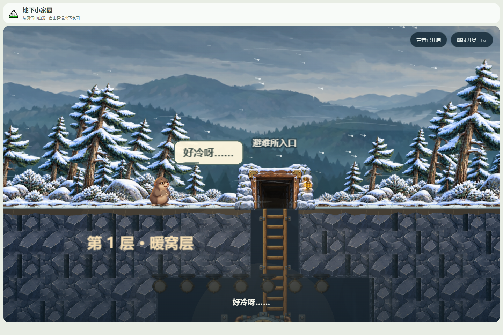

# 地下小家园 v0.2.0

2026-10-21。第二个公开版本：从第一夜的避难所，走到第二层的泉水与菜园。



## 可玩的内容

- **进入与开场**：雪景进入页读取自动存档，有存档时可以直接“继续游戏”，并显示上次玩到哪、第几步和保存时间；“重新开始”需要二次确认；页脚版本号可以打开更新记录。新档播放约 16 秒的地面演出：阿土喊冷、发现入口、避风回暖，再下梯看到停转的能源核心。
- **探索**：找到并收集能源石，修复核心，逐盏点亮第一层；给自己建一张床，伙伴入住。挖到岩壁裂纹、听见水声后换上小铁镐，按施工委托逐段破岩、接长木梯，再沿梯子下到第二层，找到天然泉水。
- **伙伴**：阿土、阿灯、小满、小泉有了名字、手绘外形和各自的出场时刻。点场景里的伙伴可以聊天；小满在第一次下到泉水层时出现，小泉从泉水里冒出来。伙伴会亲自收菜、接水、装灯；阿灯还能学会聚光灯罩，把照明覆盖从左右各 2 格扩大到各 4 格。
- **第二层家园**：把电从第一层送到第二层，壁灯真正亮起；把水接到泉边菜园，挖出种植槽，小满收菜，第一顿饭也在泉水边吃。
- **建设**：第一层和第二层都有预设洞室，点开即可“开工”，阿土沿真实通路逐格清土并自动完成设施，不需要先调大小、找位置。挖土掉落石料和旧木料，自动进入顶部物品栏，完工才扣材料。施工可以停止，已挖空间和掉落保留；撤销建造退回材料。第二层右侧仍可自由挖土、摆菜槽。
- **美术**：两人小窝和暖暖客厅使用手绘石拱、木梁、暖灯、沙发与木床；角色、物品、环境、雪面和风暴使用同风格素材，单张素材加载失败时保留程序化备用造型。

## 启动

源码需要 Node.js 与 npm：

```sh
npm ci
npm run dev -- --host 127.0.0.1 --port 3018 --strictPort
```

打开 `http://127.0.0.1:3018/`。生产验证：

```sh
npm run build
npm run preview -- --host 127.0.0.1 --port 3018 --strictPort
```

`dist/` 需要由 HTTP 静态服务器提供，不能直接双击 `index.html`。Release 另附 `Underground-Home-v0.2.0-web.zip`：解压后用 HTTP 静态服务器运行，内容与 `dist/` 一致。

## 存档与升级

- 存档格式升级到 **v13**，兼容 v12 及更早的受支持版本；旧档的地图、设施、材料、伙伴、菜园、水电、工具和探索成果继续保留。
- 使用独立试玩库 `underground-home-spring-playtest-v1`；不会写入 v0.1.0 的 `underground-home-depth-prototype-v2` 库。
- 第一次挖掘前可以点“复制 v0.1.0 进度”：只读旧双层库并另存。需要同一浏览器、同一网站来源（协议、主机、端口相同），不自动扫描其他来源。
- 读取失败时会说明原因，并禁止本次会话覆盖失败数据；重新开始之后才解除“不覆盖原档”的保护。
- 撤销栈仍只保留本次会话的挖掘和建造记录，刷新后不能撤销刷新前的操作。

## 验证

- `npm test`：34 个测试文件、**361 项全部通过**。
- `npm run build`：Vue / TypeScript 类型检查与 Vite 生产构建通过；保留既有的主包超过 500 kB 提示。
- 各阶段均保留浏览器验收记录与截图，见 `docs/acceptance/`：开场、进入页、存档、探索、伙伴互动、伙伴工作、聚光灯罩、第二层小满与菜园、预设建造、小窝与客厅美术。
- 本版本发布前在生产构建上完成 15 项浏览器冒烟：进入页版本、更新记录、开场跳过、继续游戏、旧 v10 存档载入、两层全景、新客厅美术和 430px 窄屏；页面运行时错误、资源失败和控制台 error 均为 0。详见 [发布冒烟验收](../acceptance/release-v0.2.0/README.md)。

## 已知限制

- 尚未完成 7 岁儿童现场试玩，也尚未在目标平板上做实体触控和长时间性能验收。
- 原始美术 PNG 较大，生产构建约 41 MB，首次加载在慢网或平板上会偏慢；运行时压缩版本仍待后续处理。
- 暂不支持双指捏合缩放和多指手势；以鼠标或单指点击、拖动为主。
- 尚未实现第三层、完整生态、战斗、付费、账号和后端。
- 单张素材加载失败时会使用程序化备用造型，但整体视觉一致性不如完整素材加载。

## 范围与记录

- 工程范围与决策：[首次突破岩层](../FIRST_BREAKTHROUGH_SCOPE.md)、[施工委托](../BUILDER_ORDERS_SCOPE.md)、[第二层体验优化](../SPRING_UX_SCOPE.md)、[简化建造](../PRESET_BUILDING_SCOPE.md)、[伙伴与能力成长](../PARTNER_PROGRESSION_DESIGN.md)、[小窝美术](../NEST_ART_V1.md)、[客厅美术](../LOUNGE_ART_V1.md)。
- 完整更新记录：[CHANGELOG.md](../../CHANGELOG.md)。
- v0.1.0 的版本号、标签和发布记录保持不变。
