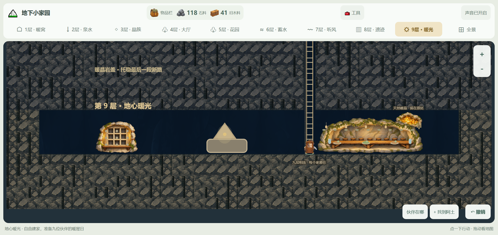

# 地下小家园 v1.0.0

2026-10-26。首个正式版：从雪地入口走到地心暖光，九层地下家园完整可玩。


## 可玩的内容

- **完整九层主线**：第一层暖窝、第二层泉水、第三层晶簇与工坊、第四层暖光大厅、第五层菌光花园、第六层蓄水回廊、第七层听风工区、第八层旧地脉遗迹、第九层地心暖光终章。每层都可以自由挖掘、扩建和布置，主线不锁死建造布局。
- **九位伙伴**：阿土、阿灯、小满、小泉、阿岩、阿木、苔苔、团团、铃铃都有独立外形、对话、实际工作、真实床位和到席路线。九人暖屋日与四层六人宴名单分开，旧伙伴顺序保留。
- **各层真实生产**：阿木把矿石加工成金属锭与部件，苔苔铺菌毯传光，团团关闸蓄水并送清水，铃铃听风、做手作并送风铃；终章的小满、团团和铃铃会把已有各层的食物、清水和风铃实际送到九层长桌。
- **九层终章**：检查暖晶接缝、装护框、逐格凿通最后一段路，自由建设暖光台、九人长桌和九层纪念壁；九位伙伴到齐才开席，玩家主动拉远镜头并手动翻完九页回忆后完成终章。完成后仍可继续建设、重读、换布置和再办暖屋日。
- **自由建设与撤销**：挖掘、设施、备餐与布置按依赖撤销；里程碑、已读回忆和已吃掉的食物不撤回。电梯连接九层，旧梯口继续可走。



## 启动

源码需要 Node.js 与 npm：

```sh
npm ci
npm run dev -- --host 127.0.0.1 --port 3018 --strictPort
```

打开 `http://127.0.0.1:3018/`。生产验证：

```sh
npm run build
npm run preview -- --host 127.0.0.1 --port 3018 --strictPort
```

`dist/` 需要由 HTTP 静态服务器提供，不能直接双击 `index.html`。Release 另附 `Underground-Home-v1.0.0-web.zip`：解压后用 HTTP 静态服务器运行，内容与 `dist/` 一致。

## 存档与升级

- 存档格式升级到 **v23**，兼容 v22 与更早受支持版本（含 v0.2.0 的 v13）；旧层地图、设施、材料、伙伴和进度继续保留。
- 地图扩至 **44×112**，前八层原有地形和两条旧梯口保留，第九层只追加新净空与暖晶岩盖。
- 继续使用 `underground-home-spring-playtest-v1` 试玩库；不会写入 v0.1.0 的旧双层库。
- 读取失败时会说明原因，并禁止本次会话覆盖失败数据；重新开始之后才解除“不覆盖原档”的保护。
- 撤销栈仍只保留本次会话的挖掘和建造记录，刷新后不能撤销刷新前的操作。

## 验证

- `npm test`：57 个测试文件、**686 项全部通过**（单 worker，避免并行资源竞争导致超时）。
- `npm run build`：Vue / TypeScript 类型检查与 Vite 生产构建通过，976 个模块；主 JS 949.65 kB、gzip 304.97 kB，保留主包超过 500 kB 的提示。
- 发布前在生产构建上完成浏览器冒烟：进入页显示 v1.0.0、更新记录、继续游戏、开场跳过、九层楼层导航、终章面板、邀请赴席和 398×756 窄屏；控制台无应用错误，应用资源请求均为 200。
- 冒烟发现并修复了 1494px 宽度下第 8、9 层与“全景”被挤出视口的问题：桌面中等宽度现在自动换成两行楼层导航，所有入口可见。
- 各层验收记录与截图见 `docs/acceptance/`；发布冒烟详情见 [release-v1.0.0](../acceptance/release-v1.0.0/README.md)。

## 已知限制

- 尚未完成 7 岁儿童现场试玩，也尚未在目标平板上做实体触控和长时间性能验收。
- 美术源文件约 104 MB，生产构建约 95 MB（v0.2.0 约 41 MB）；原始 PNG 较大，首次加载在慢网或平板上会偏慢，运行时压缩版本仍待后续处理。
- 第九层“地心暖光台”和小石凳使用程序化几何绘制，与两侧手绘设施的质感略有差异；暖晶柔光、九人就座瞬间的遮挡和桌面瓶碗落点仍需更多实机观察。
- 暂不支持双指捏合缩放和多指手势；以鼠标或单指点击、拖动为主。
- 不包含战斗、付费、账号、后端或复杂居民 AI。

## 范围与记录

- 各层范围：[三层](../LAYER3_SCOPE.md)、[四层](../LAYER4_SCOPE.md)、[五层](../LAYER5_SCOPE.md)、[六层](../LAYER6_SCOPE.md)、[七层](../LAYER7_SCOPE.md)、[八层](../LAYER8_SCOPE.md)、[九层终章](../LAYER9_SCOPE.md)。
- 完整更新记录：[CHANGELOG.md](../../CHANGELOG.md)。
- 发布验收：[release-v1.0.0](../acceptance/release-v1.0.0/README.md)。
- v0.1.0 与 v0.2.0 的版本号、标签和发布记录保持不变。
