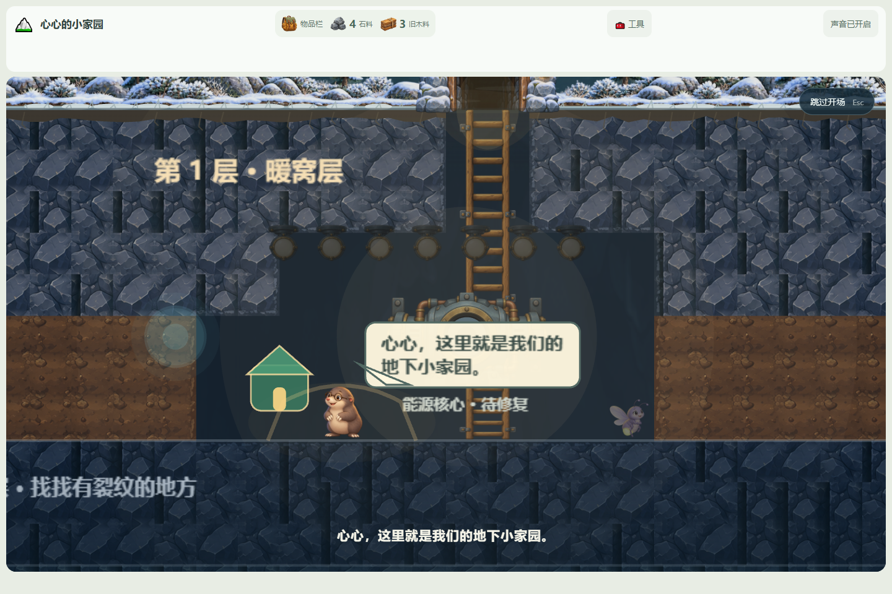
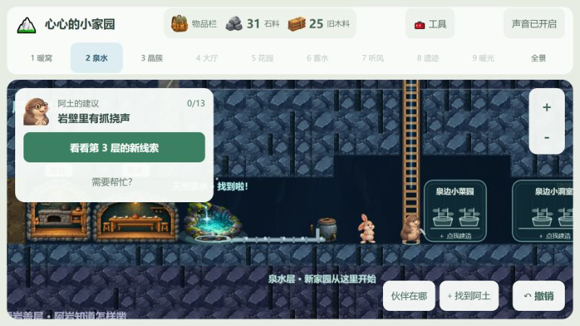

# 心心的小家园 v1.1.0

2026-10-28。这一版把家园变成“心心自己的家”：九层主线照旧可玩，新增可以把照片、录音和一句话收进存档的**记忆匣**，伙伴住下后还能请心心给小窝挂一个标记。



## 新增内容

- **记忆匣**：顶部新增「✦ 记忆匣」。可以给小标题、写一段话，也可以放一张照片或录一句声音；保存后出现在列表里，随时翻看。记录只写进当前浏览器的存档，不上传，也不发往任何服务。
- **记忆角**：放下第一条记录后，第一层大厅右侧墙上出现一个小小的记忆角。点它先看最近一条，再回到完整列表；没有记录时这里保持普通墙面，不占自由建设格。
- **小窝标记**：伙伴入住后，如果心心仍在现场，阿土会提到实际住进来的伙伴，请她为这间小窝选星星、叶子或水滴。标记挂在小窝上并写进存档，伙伴聊天时会提起自己的标记。已有住处可从房间详情重新选择，旧式独立床舱直接点舱体。
- **专属化**：进入页、标题、阿土/小满/铃铃的提示和终章文案改成对心心说话；地心暖晶称为「心心暖晶」，第九层岩壁换成一颗心形暖晶，并补了新的暖晶素材。
- **开场交接**：地面演出从 16.2 秒延长到 18.1 秒，蓝光之后先停在核心旁，由阿土说出“这里就是我们的地下小家园”，画面出现家形标记，再拉回全景交还“找到发光的能源石”。
- **发光蘑菇拾取修正**：蘑菇采下后整簇消失，不再残留菌根贴图、残光和重复光圈，空出的格子可以直接放菜槽。旧存档里已经采过的记录直接沿用新表现。
- **镜头与选址**：阿土跨层或长距离走位时镜头跟着过去，两三格的短走位只把人推回安全区；晶簇层摆放设施时先把影子放到岩壁上预览，减少误点。



## 启动

源码需要 Node.js 与 npm：

```sh
npm ci
npm run dev -- --host 127.0.0.1 --port 3018 --strictPort
```

打开 `http://127.0.0.1:3018/`。生产验证：

```sh
npm run build
npm run preview -- --host 127.0.0.1 --port 3018 --strictPort
```

`dist/` 需要由 HTTP 静态服务器提供，不能直接双击 `index.html`。

## 存档与升级

- 存档格式升到 **v25**，兼容 v24 与更早受支持版本（含 v0.2.0 的 v13）。
- v24 加入小窝标记：没有标记的旧档不会被要求补选，标记缺失时小窝照常使用。
- v25 加入生活记录：旧档自动补成空记忆匣，第一条记录保存后记忆角才出现。
- 照片上限约 1.8 MB，录音上限约 2.2 MB，一处记忆最多 100 条；媒体以 data URL 随存档保存，因此存档体积会随照片和录音增长。
- 损坏的媒体记录会被拒绝并说明原因，不会用坏档覆盖原档；读档失败的原有保护继续有效。
- 继续使用 `underground-home-spring-playtest-v1` 试玩库，不会写入 v0.1.0 的旧双层库。

## 验证

- `npm test`：**61 个测试文件、715 项全部通过**（单 worker，最终一次 99.76 秒）。本机 Git Bash 下 `npm` 脚本会因 cygwin 崩溃，改用 `node --max-old-space-size=384 node_modules/vitest/vitest.mjs run --maxWorkers=1 --pool=threads`。
- 类型检查与生产构建：`vue-tsc --noEmit` 与 `vite build` 通过。（构建产物数据见下方“构建产物”）
- 实景验收：小窝标记在约 947×592 桌面与 390×844 手机视口走通，含旧式小窝重新选择和已选状态，见[小窝标记验收](../acceptance/nest-personalization-v1/README.md)；开场用 `node docs/acceptance/opening-v2/verify.cjs` 跑完 20 项检查，覆盖八个故事阶段与 390×844、900×620，见[开场验收](../acceptance/opening-v2/README.md)；发光蘑菇在独立测试存档里实际点击验证，见[拾取验收](../acceptance/mushroom-pickup/README.md)。
- 尚未完成：记忆匣和记忆角本轮只有结构与存档回归测试，没有单独的浏览器实景记录；正式试玩前应补一次桌面与窄屏实景检查（打开记忆匣、保存一条文字、放一张照片、点记忆角回看）。

## 构建产物

- 主 JS 包 974.68 kB、gzip 313.55 kB，CSS 81.76 kB、gzip 13.49 kB；保留主包超过 500 kB 的提示。
- `dist/` 共约 94 MB，主要来自各层手绘 PNG（单张 2.5–3.0 MB）；本轮未做图片压缩。
- 构建产物里包含 `1.1.0` 版本号，进入页页脚与更新记录标题会同步显示。
- 发布前还应做一次浏览器冒烟：进入页显示 v1.1.0、更新记录首条为 1.1.0、打开记忆匣并保存一条文字、返回场景点记忆角回看、继续游戏和 390×844 窄屏。本轮未执行，见下方“尚未完成”。

## 已知限制

- 尚未完成 7 岁儿童现场试玩，也未在目标平板上做实体触控和长时间性能验收。
- 约 256×555 的极窄视口下，小窝标记面板仍可能遮挡小窝；需要在后续版本设计更紧凑的交接方式，不能只看结构断言。
- 照片和录音直接随存档保存，积累较多后存档会变大，首次读档和自动保存都会变慢；还没有导出、清理或压缩入口。
- 记忆匣依赖浏览器的文件选择与麦克风权限；录音不可用时只能改用文字或照片，界面上已有提示。
- 不支持双指捏合缩放和多指手势；不包含战斗、付费、账号、后端或复杂居民 AI。

## 范围与记录

- 完整更新记录：[CHANGELOG.md](../../CHANGELOG.md)。
- 相关验收：[小窝标记](../acceptance/nest-personalization-v1/README.md)、[发光蘑菇拾取](../acceptance/mushroom-pickup/README.md)、[地面演出](../acceptance/opening-v2/README.md)、[育苗架与发光蘑菇](../acceptance/nursery-v1/README.md)。
- 版本原则：v1.0.0 的九层内容、版本号和标签保持不变；v1.1.0 只在此基础上追加家庭记忆与小窝标记。
